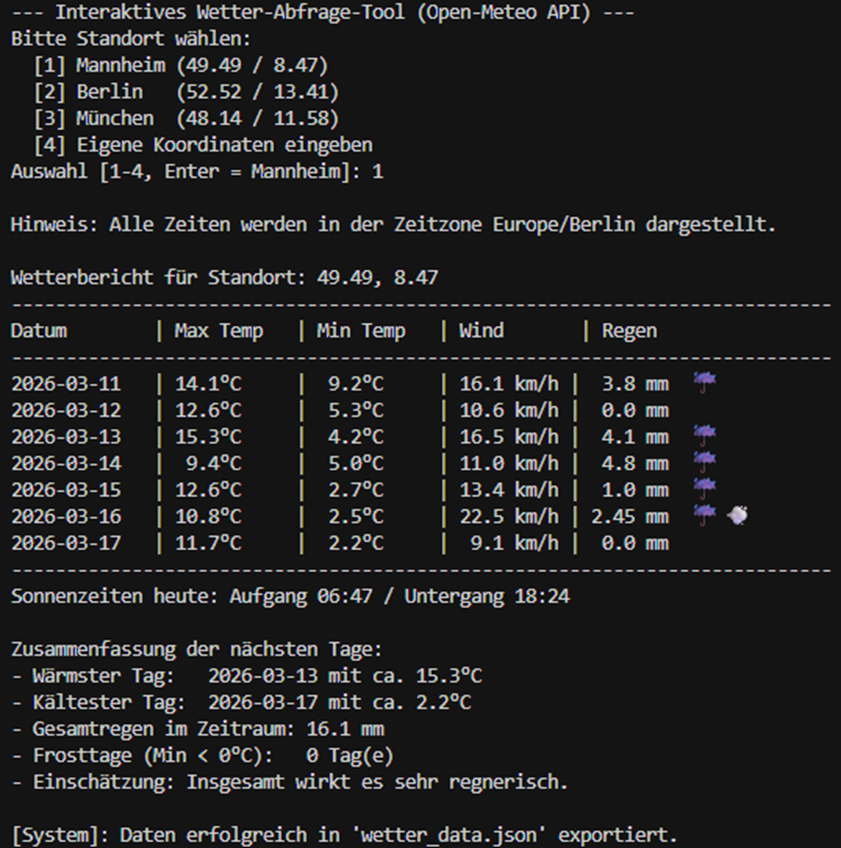
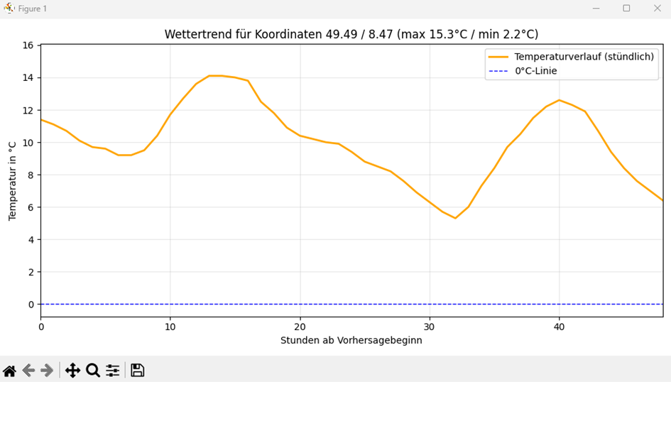
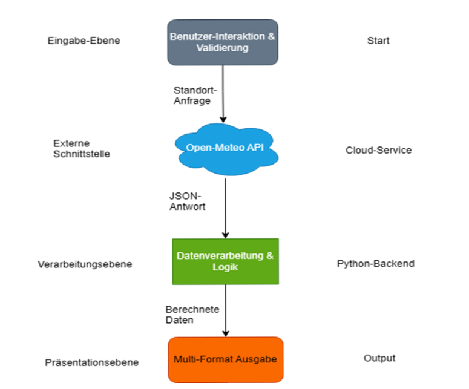

# 🌦️ Python Weather Analytics & Visualization

An interactive Python application for retrieving, analyzing, and visualizing weather forecast data using the [Open-Meteo API](https://open-meteo.com/). The project combines API integration, structured data processing, statistical analysis, and graphical visualization in a lightweight command-line application.

The application allows users to select a German city or enter a custom location, explore weather conditions, identify temperature extremes, evaluate precipitation levels, and export processed data as JSON.

---

## 🌟 Key Features

- **🌍 Flexible Location Selection** — Choose from predefined German cities or enter a custom location.
- **🔌 Weather API Integration** — Retrieve weather forecast data from Open-Meteo.
- **📊 Automated Data Analysis** — Calculate maximum and minimum temperatures, precipitation, wind conditions, and frost-related indicators.
- **🌡️ Temperature Visualization** — Generate Matplotlib charts displaying hourly temperature trends, including a reference line at 0°C.
- **🌧️ Precipitation Classification** — Categorize rainfall conditions into dry, moderate, and heavy precipitation.
- **💡 Automated Weather Insights** — Identify the warmest and coldest days and summarize relevant weather patterns.
- **📁 JSON Data Export** — Export processed weather data for further analysis or reuse.
- **🧩 Documented Data Flow** — Include a Data Flow Diagram (DFD) illustrating the application's architecture and processing pipeline.

---

## 🛠️ Tech Stack & Architecture

| Technology | Purpose |
|---|---|
| **Python** | Core application logic and data processing |
| **Open-Meteo API** | Weather forecast data source |
| **Requests** | HTTP requests and API communication |
| **Pandas** | Data processing, transformation, and analysis |
| **Matplotlib** | Weather data visualization |
| **JSON** | Structured data handling and export |

### Architecture Overview

The application follows a straightforward data-processing workflow:

1. **User Input** — Select a location and initiate the weather data request.
2. **API Communication** — Retrieve forecast data from Open-Meteo.
3. **Data Processing** — Parse the JSON response and organize the data for analysis.
4. **Weather Analytics** — Calculate relevant metrics and derive weather insights.
5. **Visualization & Export** — Display charts and analytical results, with an option to export the processed data.

This workflow demonstrates the integration of external APIs with Python-based data analysis and visualization.

---

## 📸 Application Showcase

### 1. Interactive CLI & Weather Analytics



The command-line interface guides users through location selection and presents the processed weather information, including temperature statistics, precipitation, wind conditions, and frost-related data.

### 2. Hourly Temperature Visualization



Matplotlib visualizes hourly temperature changes and highlights the freezing threshold at 0°C, making temperature trends easier to interpret.

### 3. System Architecture & Data Flow Diagram



The Data Flow Diagram illustrates how user input, the Open-Meteo API, Python processing, analytical results, visualization, and data export fit together.

---

## ⚙️ Getting Started

### Prerequisites

- Python 3.10 or newer recommended
- Internet connection for API requests
- pip package manager

### Installation & Setup

**1. Clone the repository**

```bash
git clone https://github.com/romsches/Wettervorhersage.git
cd Wettervorhersage
```

**2. Create a virtual environment (recommended)**

```bash
python -m venv .venv
```

Activate the environment:

**Windows**
```bash
.venv\Scripts\activate
```

**Linux / macOS**
```bash
source .venv/bin/activate
```

**3. Install dependencies**

```bash
pip install requests pandas matplotlib
```

**4. Run the application**

Execute the main Python script from the project directory:

```bash
python main.py
```

Replace `main.py` with the actual entry-point filename if your script uses a different name.

---

## 📈 Skills Demonstrated

- Python application development
- REST API integration and HTTP requests
- JSON parsing and structured data processing
- Data analysis with Pandas
- Statistical summaries and weather metrics
- Data visualization with Matplotlib
- Automated insight generation using rule-based analysis
- Data export and technical documentation

---

## 🎯 Project Purpose

This project was developed to strengthen practical skills in Python development and data-oriented programming as part of my progression toward data science and AI engineering.

It demonstrates how external data can be retrieved, processed, analyzed, and transformed into meaningful visual insights through a structured application workflow.

---

## 🚀 Potential Enhancements

- Add historical weather data analysis and comparisons.
- Introduce interactive charts and dashboards.
- Implement additional statistical indicators and configurable analysis periods.
- Add automated tests for data processing and API response handling.
- Extend the application with more locations and weather metrics.

---

## 📂 Repository

**GitHub:** [romsches/Wettervorhersage](https://github.com/romsches/Wettervorhersage)

